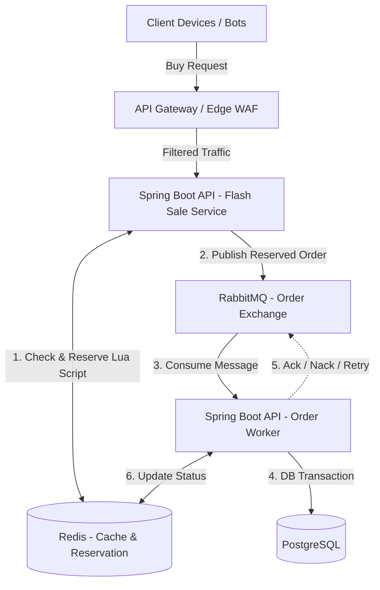

# Flash Sale System

A highly concurrent, highly available Flash Sale (Inventory Reservation) System capable of safely handling 100,000+ concurrent requests for a limited inventory (e.g., 100 items), without overselling, deadlocks, or database crashes.

## Problem

- **100,000 concurrent requests** hitting the `Buy` button simultaneously.
- **100 inventory** exactly, absolutely no overselling allowed.
- Massive threat from bot networks executing millisecond-precision aggressive requests.
- Traditional relational database architectures (like direct `UPDATE inventory SET stock = stock - 1`) will experience massive row-level lock contention, CPU spikes, and likely crash or freeze.

## Architecture



## Tech Stack
- **Java 17** & **Spring Boot 3.3**
- **PostgreSQL 15** (Source of truth & permanent storage)
- **Redis 7** (Atomic inventory reservations & Rate Limiting)
- **RabbitMQ 3** (Asynchronous processing buffer)
- **Docker & Docker Compose** (Containerization)
- **Flyway** (Database Migrations)
- **k6** (Load Testing)

## Core Design

The core philosophy of this architecture is **Fail Fast**, **Queue for Processing**, and **Asynchronous Consistency**.

### Anti Overselling
Overselling is prevented entirely at the **Redis Layer** using a single-threaded Lua script (`reserve_inventory.lua`).
The script atomically checks if stock > 0, checks if the user has already bought, decrements the stock, and records the reservation. Because Redis evaluates Lua scripts atomically, 100,000 requests are processed safely without race conditions.

### Message Queue (RabbitMQ)
The 100 successful reservations from Redis are instantly pushed into a RabbitMQ queue (`flash-sale.order.queue`). This acts as a shock absorber. It returns HTTP 202 immediately to the user while decoupling the fast Redis reservation from the slow PostgreSQL relational transaction.

### Database Consistency (PostgreSQL)
A worker consumes messages at a safe pace. It opens a `@Transactional` boundary, inserts the Order, inserts the OrderItem, and strictly decrements the available DB stock. If the DB crashes, the transaction rolls back cleanly.

### Idempotency
To guarantee an **Exactly-Once Business Effect**:
1. Clients generate an `idempotencyKey` UUID.
2. The Redis Lua script blocks duplicates for 24h.
3. The DB worker stores the key in an `idempotency_records` table with a `UNIQUE` constraint, catching any extreme edge cases of MQ redelivery.

### Anti Bot & Security
1. **Timestamp Validation:** Rejects requests older/newer than ±30 seconds.
2. **HMAC-SHA256 Signature:** Protects payload integrity (no tampered quantity or ID).
3. **Replay Protection:** Redis caches the signature hash temporarily to prevent exact payload replays.

### Rate Limiting
A custom Lua script sliding window/token bucket limits per-user and per-IP requests. Suspicious users face stricter limits.

### Failure Handling & DLQ
If the Database goes down or throws constraint errors, the RabbitMQ worker retries exactly 3 times (with exponential backoff). After that, the message is routed to the Dead Letter Queue (`flash-sale.order.dlq`) for manual intervention or compensating transactions (reverting Redis stock).

---

## API Documentation

### `POST /api/v1/flash-sale/buy`

**Headers:**
- `X-User-Id`: `12345`
- `Content-Type`: `application/json`

**Body:**
```json
{
  "flashSaleId": 1,
  "productId": 100,
  "quantity": 1,
  "idempotencyKey": "unique-uuid-1234",
  "timestamp": 1696580000,
  "signature": "base64-hmac-sha256"
}
```

**Responses:**
- `202 Accepted` (Reservation queued)
- `409 Conflict` (Sold Out)
- `429 Too Many Requests` (Rate Limited)
- `401 Unauthorized` (Invalid Signature / Replay Attack / Expired)

---

## Getting Started

### Run Locally (Docker Compose)
1. Clone the repository.
2. Create `.env` from `.env.example`.
3. Start the entire stack:
   ```bash
   docker compose up -d
   ```
   *Note: This will spin up PostgreSQL, Redis, RabbitMQ, and the Spring Boot application itself.*

### Run Tests
```bash
# Requires Docker running for Testcontainers
mvn clean test
```

### Run Load Test
```bash
# Simulates 100,000+ requests using k6
k6 run load-test/flash-sale.js
```

### Verify Result
Check if the exact amount of 100 inventory was sold without overselling:
```bash
python load-test/verify-result.py
```

## Expected Result & Benchmark
- **Expected Final DB Inventory:** 100 orders maximum.
- **Expected Redis Inventory:** 0.
- **Expected DB Constraints Violated:** 0.
- **Benchmark Metrics:** NOT RUN (Execute in a live environment to populate metrics).
