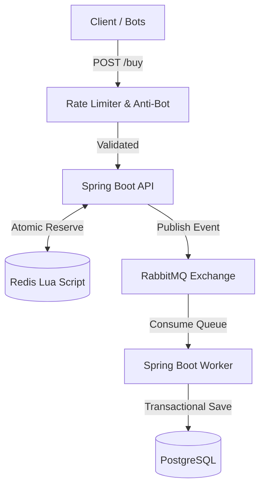
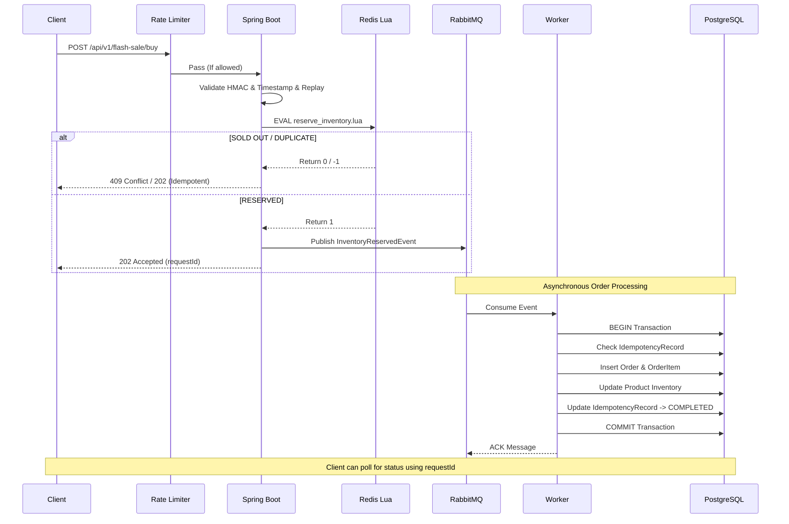
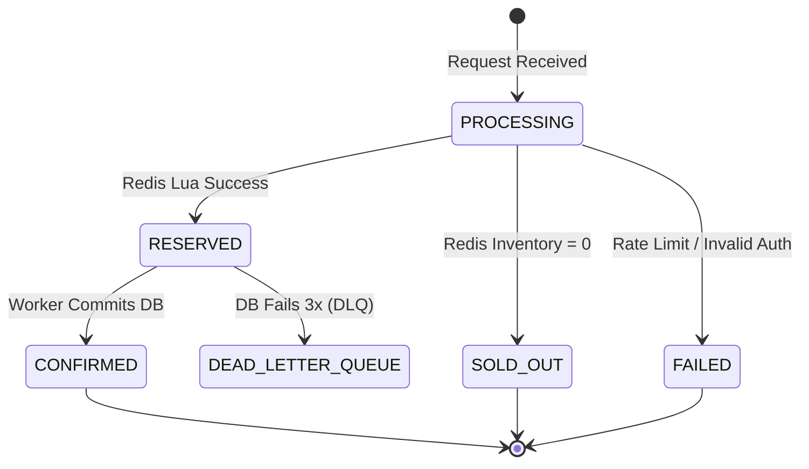
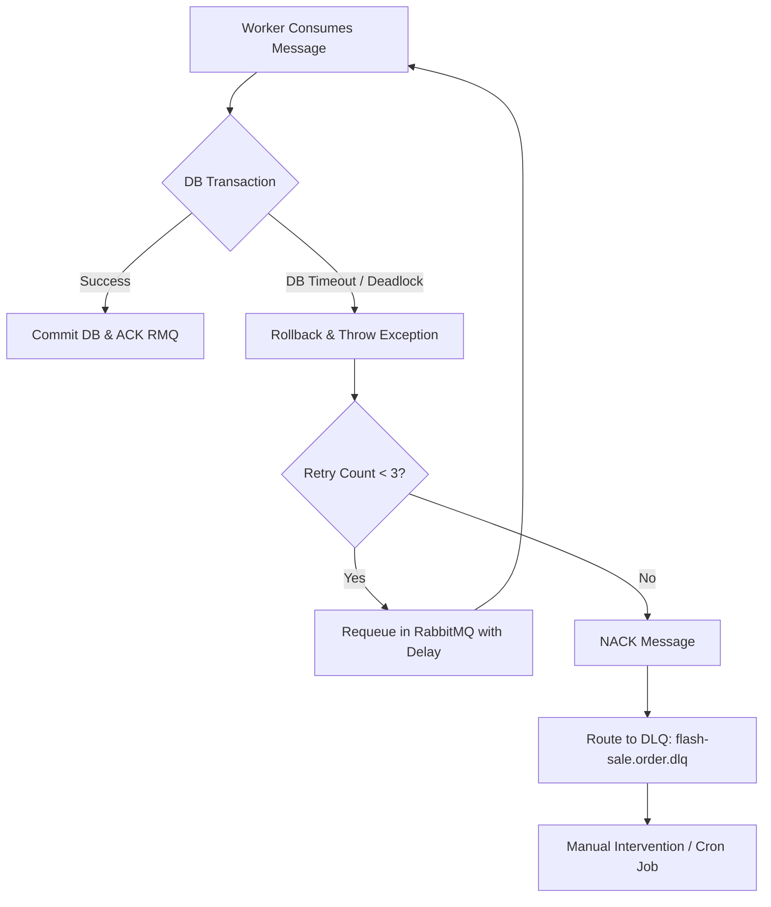

# High Concurrency Flash Sale System - Architecture

## 1. System Architecture Overview

The system handles 100,000+ concurrent requests by strictly adhering to a **Queue-Based Asynchronous** architecture utilizing Redis for edge-level atomic checks and RabbitMQ for persistent buffer.

### 1.1 Architecture Diagram

### 1.2 Sequence Diagram

### 1.3 State Diagram

### 1.4 Failure Recovery Diagram

