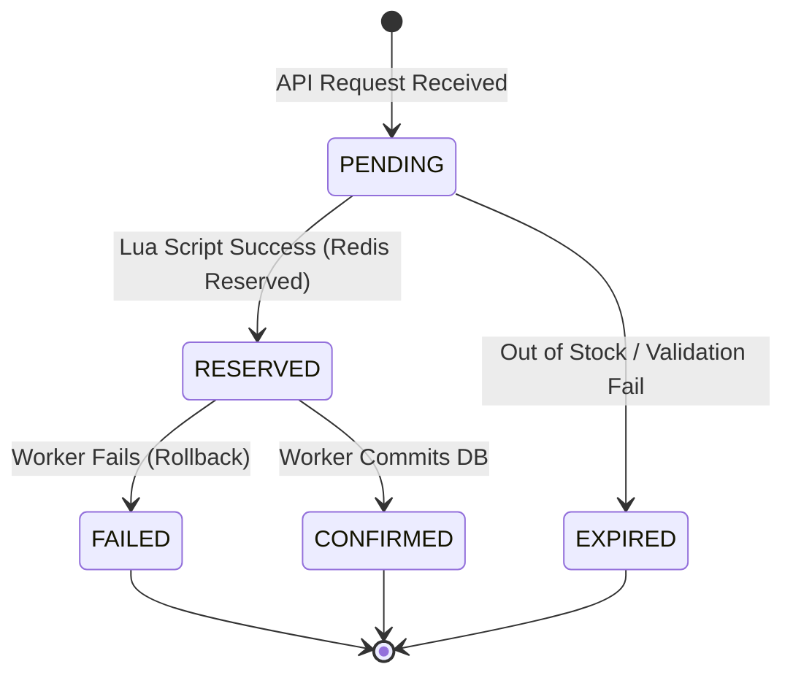
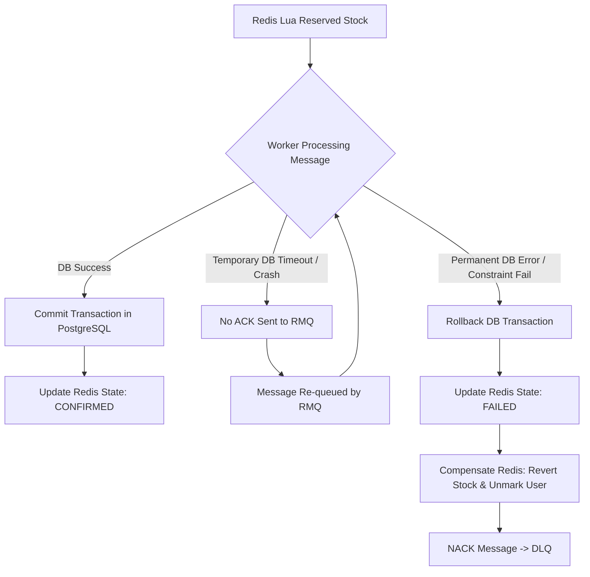

# Flash Sale System Design

## 1. Concurrency Analysis & Bottlenecks

### Why not decrement inventory directly in PostgreSQL?
If 100,000 requests hit PostgreSQL simultaneously to execute an `UPDATE inventory SET stock = stock - 1 WHERE item_id = X AND stock > 0`:
1. **Row-level Locks:** PostgreSQL uses row-level locking for `UPDATE`. 100,000 connections will try to acquire an exclusive lock on the single row representing the Flash Sale item.
2. **Lock Contention & Deadlocks:** This massive lock contention leads to blocked connections, high CPU utilization, and eventually connection pool exhaustion or query timeouts.
3. **Database Crash:** The database would become a major bottleneck, potentially crashing the entire system and affecting other services sharing the database.

### Alternative Approaches Comparison

| Approach | Description | Pros | Cons | Verdict |
|----------|-------------|------|------|---------|
| **Pessimistic Locking** | `SELECT ... FOR UPDATE` | Strict consistency | Terrible performance under high concurrency. Deadlocks. | **Reject** |
| **Optimistic Locking** | `@Version` annotation | No DB locks | 99,900 requests will fail with `OptimisticLockException` and require retry, wasting resources. | **Reject** |
| **Atomic SQL UPDATE** | `UPDATE ... WHERE stock > 0` | Simple, atomic | Still causes massive lock contention on a single row. | **Reject** |
| **Redis Atomic Decrement** | `DECR` | Extremely fast (memory) | Risk of overselling if `DECR` goes below 0 and isn't checked atomically alongside user limits. | **Reject** |
| **Redis Lua Script** | Custom Lua script | Atomic, extremely fast, complex logic (check + reserve + mark user) in one operation. | Requires maintaining consistency between Redis and DB. | **Select for Edge** |
| **Queue-based** | RabbitMQ buffer | Smooths out traffic, protects DB. | Asynchronous, eventual consistency. | **Select for Core** |

## 2. Chosen Architecture: Redis Lua + RabbitMQ

To handle 100,000 requests, we must **Fail Fast** at the Redis layer. 

1. **Redis Lua Script:** Evaluated atomically in Redis (single-threaded). The script checks if stock > 0 and if the user hasn't bought yet. If yes, it decrements stock, marks the user as "purchased", and returns success. If no, it returns failure. This handles 100,000 requests in milliseconds, dropping 99,900 requests immediately without touching the MQ or Database.
2. **RabbitMQ:** The 100 successful requests are published to a RabbitMQ queue. 
3. **PostgreSQL Worker:** A worker consumes the queue slowly (e.g., 10 messages/sec), updating the database safely.

## 3. Critical Concerns & Solutions

### Overselling Prevention
- **At Redis Level:** The Lua script guarantees atomicity. Since Redis executes scripts synchronously, it's impossible for two requests to read the same stock value and decrement it below 0. 
- **At DB Level:** A secondary constraint `CHECK (stock >= 0)` on the PostgreSQL table ensures that even in edge cases, the DB will reject overselling.

### Idempotency & Duplicate Requests
- Users might spam the "Buy" button or bots might send concurrent requests.
- The Redis Lua script checks if the `UserID` has already purchased the item. If a `UserID` exists in a Redis Set (e.g., `flash_sale:item_id:purchased_users`), the script immediately rejects the duplicate request.
- The message published to RabbitMQ contains a unique `OrderID`. PostgreSQL enforces idempotency with a `UNIQUE` constraint on `(user_id, item_id)`.

### Message Redelivery, Retry, and Crash Recovery
- If the Order Worker crashes mid-processing, RabbitMQ will not receive an `ACK`. 
- Unacknowledged messages are automatically requeued (Redelivery). 
- To avoid infinite loops on poisonous messages (e.g., DB constraint violations), we implement a Dead Letter Queue (DLQ). If a message fails multiple times (e.g., 3 retries), it's routed to the DLQ.

### Redis/PostgreSQL Consistency
- **Scenario:** Redis reserves stock, but the DB update fails permanently (e.g., data validation error in worker).
- **Solution (Compensating Transaction):** If the worker completely fails to insert the order (after retries), the worker executes a compensating action:
  1. Increment Redis stock (`INCR`).
  2. Remove UserID from the purchased set.
  3. Update Order State in Redis to `FAILED`.
- **Scenario:** Worker processes order, commits DB, but crashes before updating Redis state to `CONFIRMED`.
- **Solution:** The user queries the API, the API sees `PENDING` (or `RESERVED`) in Redis. A background cron job reconciles incomplete orders by checking the DB. If DB has the order, it updates Redis to `CONFIRMED`.

### Fairness
- Requests are processed First-Come-First-Serve at the API/Redis layer. Redis processes commands strictly sequentially.
- Pre-filtering at Edge/Gateway prevents a single bot network from monopolizing the TCP connections.

## 4. State Machine Design

Orders flow through a strict state machine to prevent race conditions and ensure traceability.

## 5. Failure Scenarios Handling

## 6. Implementation Checklist

### Phase 1: Infrastructure Setup
- [ ] Setup Docker Compose (PostgreSQL, Redis, RabbitMQ).
- [ ] Initialize Database schemas (Items, Inventory, Orders).
- [ ] Configure Spring Boot Data JPA & connection pools.

### Phase 2: Core Components
- [ ] Implement Redis configuration and `RedisTemplate`.
- [ ] Write the Lua Script (`reserve_stock.lua`) for atomic decrement & user tracking.
- [ ] Setup RabbitMQ Exchanges, Queues, and DLQ.

### Phase 3: APIs & Workers
- [ ] Implement `FlashSaleController` (`POST /buy`).
- [ ] Implement `FlashSaleService` (Calls Lua script, publishes to MQ).
- [ ] Implement `OrderWorker` (Consumes MQ, `@Transactional` DB update).
- [ ] Implement `OrderQueryService` (Client polling endpoint for status).

### Phase 4: Reliability & Testing
- [ ] Add compensation logic (Worker failure reverts Redis).
- [ ] Implement JUnit 5 tests.
- [ ] Setup Testcontainers for Redis/Postgres integration tests.
- [ ] Implement JMeter/Gatling tests to simulate 100,000 concurrent requests.
